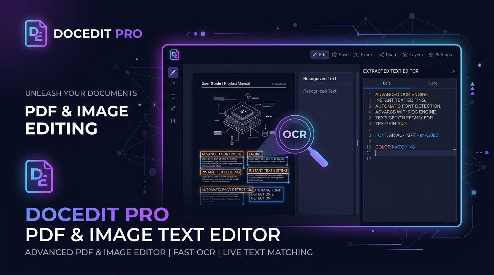
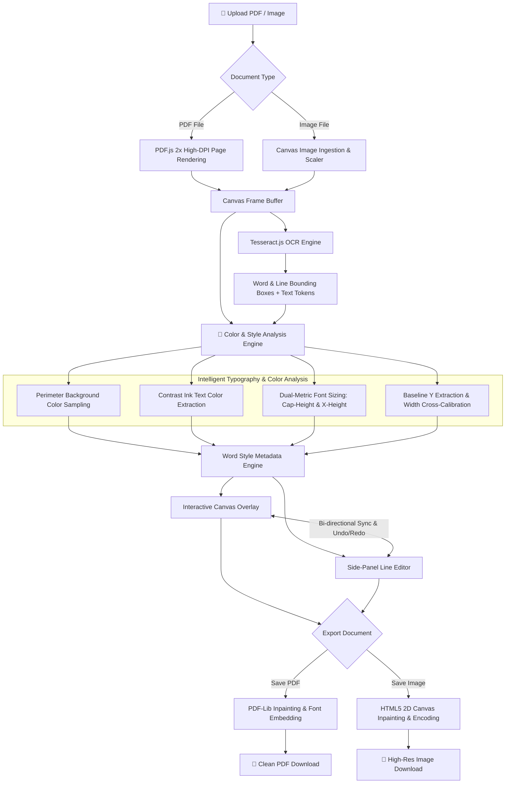
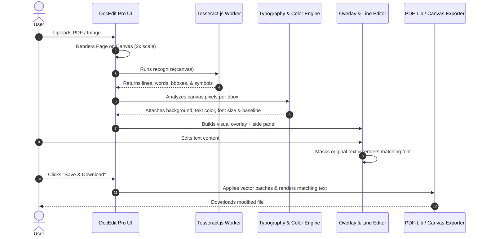

# DocEdit Pro — PDF & Image Text Editor 📝

<div align="center">



[](https://techyshahid.github.io/ImageOCR/)

[](LICENSE)
[](https://github.com/naptha/tesseract.js)
[](https://pdf-lib.js.org/)
[](#privacy--security)
[](https://github.com/TechyShahid/ImageOCR/pulls)

**DocEdit Pro** is an open-source, client-side web application for in-browser OCR, direct text editing, and document export for PDFs and images (PNG, JPEG, WebP). It automatically analyzes and replicates the original document's typography, font size, text color, and background color for edits.

[🚀 **Try Live Demo**](https://techyshahid.github.io/ImageOCR/) • [Features](#-key-features) • [Architecture](#-architecture--pipeline) • [How It Works](#-how-it-works) • [Getting Started](#-getting-started) • [Shortcuts](#-keyboard-shortcuts) • [Privacy](#-privacy--security)

</div>

---

## ✨ Key Features

- **🔍 Client-Side OCR**: Powered by Tesseract.js v5 with multi-word bounding box detection, character tracking, and line extraction.
- **🎨 Color Sampling Engine**: Samples the perimeter ring around bounding boxes to capture the background color, and isolates high-contrast ink pixels to extract text color.
- **📐 Typographic Calibration**:
  - Computes font size from line-level metrics, cap-height ($\text{capHeight} / 0.714$), and x-height ($\text{xHeight} / 0.523$).
  - Cross-calibrates against standard glyph widths using offscreen canvas context measurement.
  - Aligns replacement text with the original line's typographic baseline.
- **⚡ Dual-Mode Editing**:
  - **Direct Canvas Overlay**: Click and edit words directly on top of the document canvas.
  - **Extracted Text Side Panel**: Line-by-line synchronized text editor with bi-directional scrolling and real-time word synchronization.
- **💾 Multi-Format Export**:
  - **PDF Export**: Inpaints background rectangles and embeds matching font families (`Helvetica`, `Times Roman`, `Courier` in regular, bold, and italic) with baseline alignment.
  - **Image Export**: Generates lossless PNG, JPEG, or WebP images with matched typography and background color fills.
- **🔒 100% Client-Side Privacy**: All OCR processing, PDF rendering, editing, and saving happens entirely inside the user's browser. No documents or data are sent to any remote server.
- **🎯 Full Editor Controls**: Smooth pan & zoom (fit to width, up to 300%), multi-level undo/redo history (`Ctrl/Cmd + Z`), page navigation for multi-page PDFs, and keyboard shortcuts.

---

## 🏗️ Architecture & Pipeline



---

## 🔬 How It Works

### 1. Optical Character Recognition (OCR)
When a file is loaded, DocEdit Pro renders the page onto a high-DPI canvas. The OCR engine identifies words, coordinates $(x_0, y_0, x_1, y_1)$, line groupings, and character symbols.



### 2. Dual-Metric Font Sizing & Baseline Alignment
Rather than using arbitrary word heights (which shrinks lowercase-only words like `"man"` or `"one"`), the engine analyzes:
$$\text{fontSize} = \frac{\text{capHeight}}{0.714} = \frac{Y_{\text{baseline}} - Y_{\text{capTop}}}{0.714}$$
$$\text{xHeight} = Y_{\text{baseline}} - Y_{\text{xTop}} \implies \text{fontSize} = \frac{\text{xHeight}}{0.523}$$

The calculated size is cross-calibrated against horizontal text tracking measurements using `ctx.measureText()`, and replacement text is anchored to the original typographic baseline.

### 3. Background Inpainting
The background color is sampled from the outer 2-pixel perimeter of the bounding box. When text is modified, a solid patch matching the exact background color covers the original ink before rendering the new text.

---

## 💻 Tech Stack

| Component | Technology | Description |
|---|---|---|
| **Core UI** | HTML5, CSS3, ES Modules | Modern glassmorphism dark-mode UI |
| **OCR Engine** | [Tesseract.js v5](https://tesseract.projectnaptha.com/) | Pure client-side WebAssembly OCR |
| **PDF Rendering** | [PDF.js v4](https://mozilla.github.io/pdf.js/) | Mozilla's client-side PDF renderer |
| **PDF Generation** | [PDF-Lib v1.17](https://pdf-lib.js.org/) | In-browser PDF modification and font embedding |
| **Canvas Processing** | HTML5 Canvas 2D API | Sub-pixel raster manipulation and color sampling |

---

## 🚀 Getting Started

### Prerequisites
A modern web browser (Chrome, Firefox, Safari, Edge) that supports WebAssembly and ES Modules.

### Running Locally

1. **Clone the repository**:
   ```bash
   git clone https://github.com/TechyShahid/ImageOCR.git
   cd ImageOCR
   ```

2. **Start a local web server**:
   Using Python:
   ```bash
   python3 -m http.server 8080
   ```
   Or using Node (`npx`):
   ```bash
   npx serve .
   ```
   Or using PHP:
   ```bash
   php -S localhost:8080
   ```

3. **Open in browser**:
   Navigate to `http://localhost:8080`.

---

## ⌨️ Keyboard Shortcuts

| Shortcut | Action |
|---|---|
| <kbd>⌘</kbd> / <kbd>Ctrl</kbd> + <kbd>Z</kbd> | Undo last text modification |
| <kbd>⌘</kbd> / <kbd>Ctrl</kbd> + <kbd>⇧ Shift</kbd> + <kbd>Z</kbd> | Redo text modification |
| <kbd>⌘</kbd> / <kbd>Ctrl</kbd> + <kbd>S</kbd> | Save & Download modified document |
| <kbd>⌘</kbd> / <kbd>Ctrl</kbd> + <kbd>+</kbd> / <kbd>=</kbd> | Zoom In |
| <kbd>⌘</kbd> / <kbd>Ctrl</kbd> + <kbd>-</kbd> | Zoom Out |
| <kbd>Tab</kbd> | Focus next editable word |
| <kbd>Enter</kbd> | Confirm word edit and blur |
| <kbd>Esc</kbd> | Dismiss active word focus |

---

## 🛡️ Privacy & Security

DocEdit Pro is engineered with a **zero-telemetry, offline-first** architecture:
- ✅ **No Server Uploads**: Files are never transmitted across the network.
- ✅ **Local Execution**: All OCR, canvas rendering, and PDF generation execute locally inside the browser's JavaScript sandbox.
- ✅ **Safe for Sensitive Documents**: Invoices, contracts, medical records, and identification documents remain private on your device.

---

## 📄 License

This project is licensed under the [MIT License](LICENSE).

---

<div align="center">
  <sub>Built with ❤️ by <a href="https://github.com/TechyShahid">Shahid Khan</a></sub>
</div>
